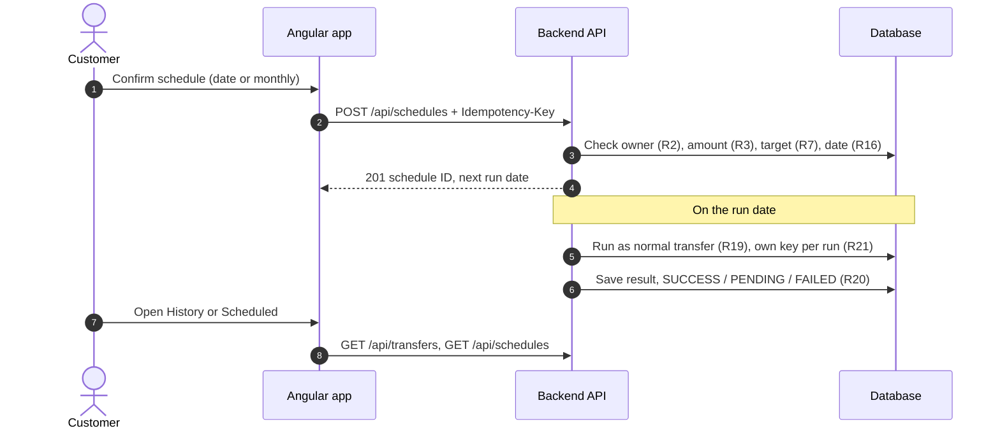

# PRD: Scheduled transfers (Lab Bank)

Extends [PRD.md](PRD.md). Rules R1–R14 and the existing error codes in that file still apply. This file does not repeat them. New rules start at R15.

## Goal

Let a logged-in customer set up a transfer that runs later: once on a future date, or every month until they stop it.

## Users

Retail customers who already use Transfer, for example to pay rent or a monthly instalment on the same day each month.

## Flow

1. On **Transfer**, the customer fills the usual fields (source account, bank, target account, amount, note) and picks a timing: **Now** (as today), **On a date**, or **Every month**.
2. For **On a date**, the customer picks the date. For **Every month**, the customer picks the first date and may pick an end date.
3. The app runs the inquiry (R7) and shows a confirm page with the beneficiary name, the timing and the next run date.
4. The customer confirms. The app shows a schedule receipt with a schedule ID. No money moves yet.
5. On each run date, the system makes a normal transfer. The result shows in **History**, with its own reference number.
6. In **Scheduled**, the customer sees active schedules with the next run date, and can cancel one.

## Rules

| ID | Rule |
|---|---|
| R15 | A schedule is an instruction only. Creating it does not debit or credit any account. |
| R16 | The first run date must be after today in WIB (tomorrow at the earliest). A past date or today is rejected with `INVALID_SCHEDULE_DATE`. |
| R17 | **Every month** repeats on the same day of the month as the first date, until the customer cancels it or the optional end date passes. |
| R18 | At creation, R2, R3, R6, R7 and R13 apply. R4 (daily limit) and R5 (balance) are not checked then, because they can change before the run date. |
| R19 | Each run is a normal transfer, and R2–R6, R8–R11 are checked again on the run date. Amount, target and note stay as saved. |
| R20 | If a run fails a rule, nothing is debited. The run is saved as `FAILED` with the error code and shown in History. Later monthly runs are not stopped by one failed run. |
| R21 | Each run has its own idempotency key built from the schedule ID and the run date, so a run never debits twice (R10). |
| R22 | The customer can cancel a schedule before its next run. A cancelled schedule never runs again. Runs already done stay in History. |
| R23 | Only the owner of the source account can create, see or cancel a schedule (R2). Each run shows a receipt as in R14. |
| R24 | Schedule data follows R11, R12 and R13: `BigDecimal` amount, masked account numbers on screen and in logs, note as plain text. |

## Error codes

New codes. The codes in [PRD.md](PRD.md#error-codes) are reused as they are.

| Code | HTTP | When |
|---|---|---|
| `INVALID_SCHEDULE_DATE` | 422 | First date is today or in the past, or the end date is before the first date |
| `SCHEDULE_NOT_FOUND` | 404 | Schedule ID does not exist or is not yours |
| `SCHEDULE_NOT_CANCELLABLE` | 409 | Schedule is already cancelled or finished |

A failed run (R20) is not an HTTP error. It is a `FAILED` entry in History that carries one of the existing codes, for example `INSUFFICIENT_FUNDS`.

## Open questions

These are not decided. Where the rules above assume an answer, the question says so. Each needs an owner before build.

1. **Day 29, 30, 31.** If the first date is the 31st, what happens in a month with fewer days? Options: run on the last day of the month, or skip the month.
2. **Run time.** At what time on the run date does the job run? This decides how R8 (15.00 WIB cut-off) applies to other-bank schedules. Runs after 15.00 would become `PENDING`.
3. **Retry.** Should a run that failed for `INSUFFICIENT_FUNDS` be retried later the same day or the next day, or not at all (as R20 now assumes)?
4. **Stop after repeated failures.** Should a monthly schedule be cancelled automatically after some number of failed runs in a row?
5. **Maximum horizon.** Is there a limit on how far ahead the first date can be, and a limit on active schedules per customer?
6. **Notification.** Should the customer be told about a failed run outside the app? Today the app has no notification channel.
7. **Editing.** Can a customer change amount or date, or must they cancel and create again? This PRD assumes cancel and create again.
8. **Daily limit (R4).** Do scheduled runs count toward the limit on the run date, as R19 assumes, and are they processed before or after transfers the customer makes by hand that day?
9. **Public holidays and weekends.** For Lab Bank to Lab Bank, runs happen on the date. Is that also right for other-bank transfers, given R8 sends them on the next business day?
10. **Mid-schedule changes.** What happens to a schedule if the target account is closed or the source account is blocked? This PRD treats it as a failed run.

## Out of scope (for now)

- Weekly, daily or yearly repeat, and "every N months".
- Editing a schedule.
- Fixed number of repeats ("repeat 6 times").
- Skipping or pausing a single run.
- Push, SMS or email notifications.
- OTP / second factor and fees (as in [PRD.md](PRD.md#out-of-scope-for-now)).
