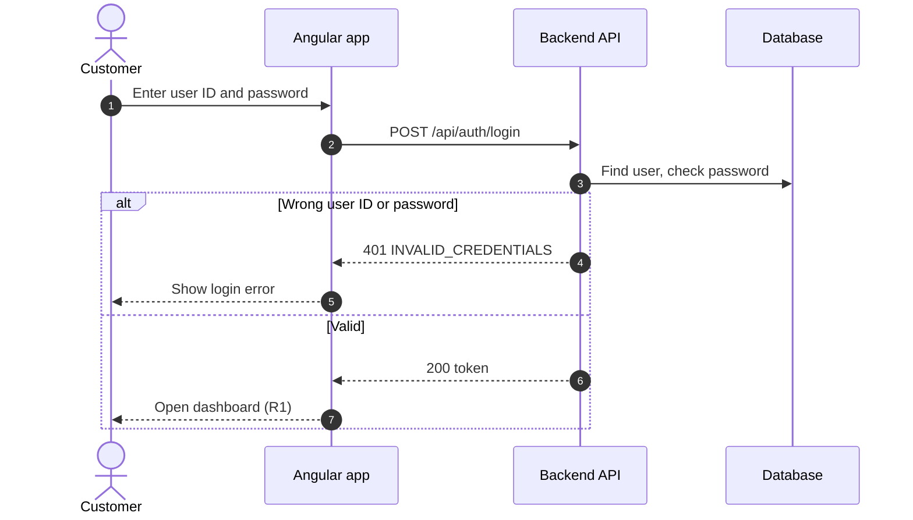
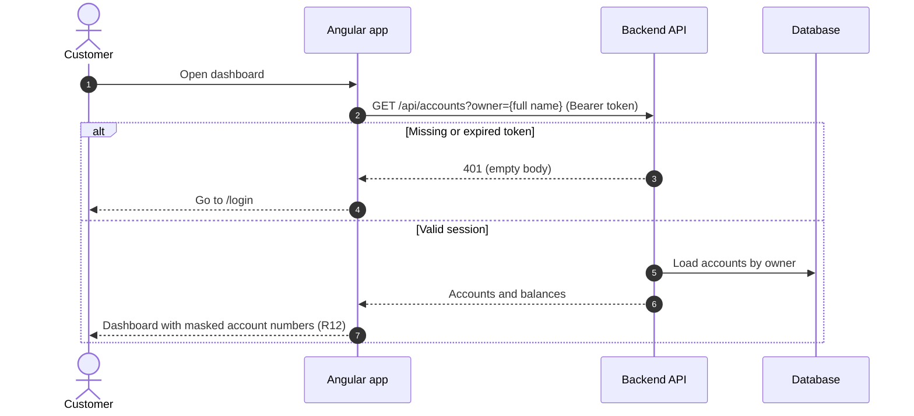
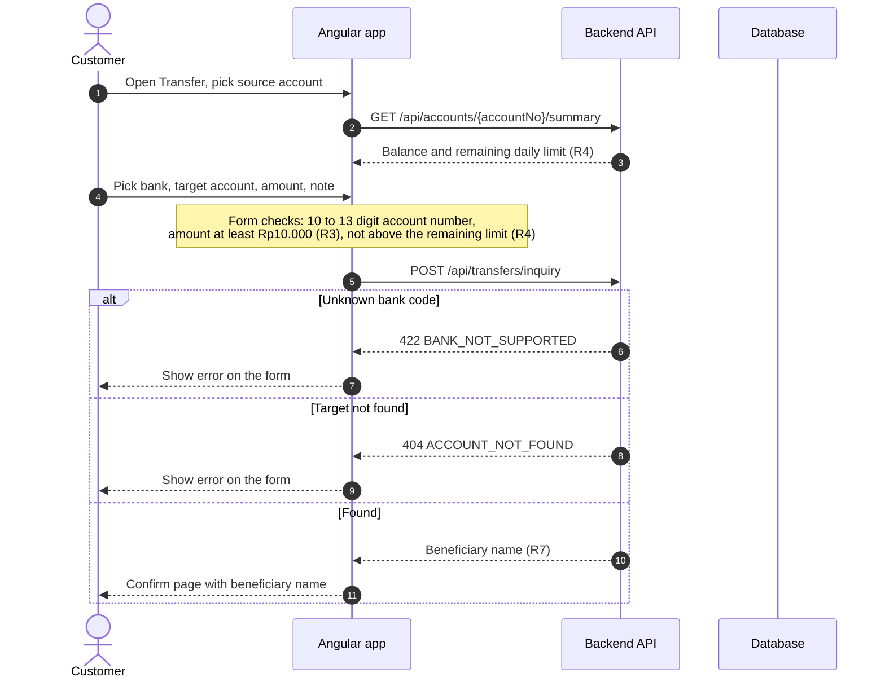
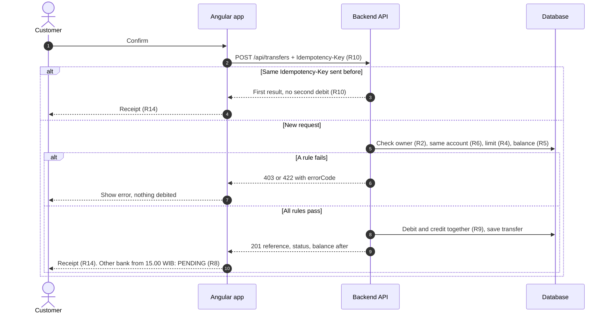
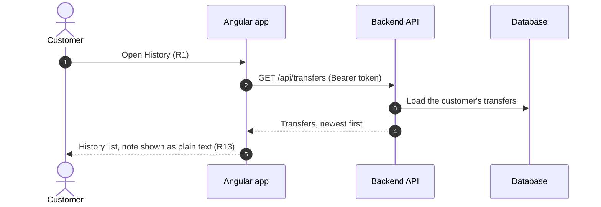

# PRD: Fund transfer (Lab Bank)

## Goal

Let a logged-in customer send money from their own account to another account at Lab Bank or at another bank, safely and with a clear receipt.

## Users

Retail customers with one or more savings or current accounts.

## Flow

1. The customer logs in with user ID and password.
2. The dashboard shows their accounts and balances.
3. On **Transfer**, the customer picks the source account, the bank, the target account, the amount and an optional note.
4. The app checks the target account (inquiry) and shows the beneficiary name on a confirm page.
5. The customer confirms. The app shows a receipt with a reference number.
6. The transfer appears in **History**.

### Sequences

One diagram per flow, in the order the customer meets them. Rule IDs (R1–R14) are listed under [Rules](#rules), error codes under [Error codes](#error-codes).

#### 1. Login

`POST /api/auth/login`. No token is needed yet; every other call below carries the token from this step.

#### 2. Accounts and balances

`GET /api/accounts?owner={full name}` with the Bearer token. A missing or expired token sends the customer back to login (R1).

#### 3. Transfer inquiry

The customer fills the form, the app loads the remaining daily limit, then asks the API who owns the target account before showing a confirm page (R7).

#### 4. Post transfer

The commit step. The request carries an `Idempotency-Key` (R10); the API re-checks every rule before moving any money.

#### 5. History

`GET /api/transfers` with the Bearer token. The API returns only the transfers of the logged-in customer, newest first.

## Rules

| ID | Rule |
|---|---|
| R1 | Only logged-in users can open the dashboard, transfer and history pages. Guests go to `/login`. |
| R2 | The source account must belong to the logged-in user. Otherwise: 403. |
| R3 | Amount must be more than 0. The minimum is **Rp10.000**. |
| R4 | Daily limit is **Rp50.000.000 per source account**, counted from 00.00 WIB. A transfer that would go over it is rejected with `LIMIT_EXCEEDED`. |
| R5 | The amount cannot be more than the source balance (`INSUFFICIENT_FUNDS`). |
| R6 | Source and target cannot be the same Lab Bank account (`SAME_ACCOUNT`). |
| R7 | The target account must exist. The inquiry shows the beneficiary name before the customer confirms. |
| R8 | **Cut-off 15.00 WIB** for transfers to other banks. From 15.00 the transfer is accepted with status `PENDING` and sent on the next business day. Transfers inside Lab Bank are always instant (`SUCCESS`). |
| R9 | Debit and credit happen together. If one fails, neither is saved. |
| R10 | If the same request is sent again with the same `Idempotency-Key`, the system returns the first result and does not debit the account twice. |
| R11 | Money uses `BigDecimal`, scale 2, rounding `HALF_EVEN`. All amounts in the API are in rupiah. |
| R12 | Account numbers are masked on screen (`******7890`). Account numbers and NIK are never written to logs in clear text. |
| R13 | The note is optional, up to 100 characters, and is always shown as plain text. |
| R14 | The receipt shows the reference number, status, beneficiary, amount, note and the balance after the transfer. |

## Error codes

| Code | HTTP | When |
|---|---|---|
| `INVALID_REQUEST` | 400 | Missing fields, amount ≤ 0 |
| `INVALID_CREDENTIALS` | 401 | Wrong user ID or password |
| (empty body) | 401 | Missing or expired token |
| `FORBIDDEN` | 403 | Source account is not yours |
| `ACCOUNT_NOT_FOUND` | 404 | Source or target account not found |
| `BELOW_MINIMUM` | 422 | Amount below Rp10.000 |
| `LIMIT_EXCEEDED` | 422 | Over the daily limit |
| `INSUFFICIENT_FUNDS` | 422 | Not enough balance |
| `SAME_ACCOUNT` | 422 | Source and target are the same |
| `BANK_NOT_SUPPORTED` | 422 | Unknown bank code |

## Out of scope (for now)

- Scheduled (future-dated) transfers. This is the Session 4 spec exercise.
- OTP / second factor.
- Fees.
