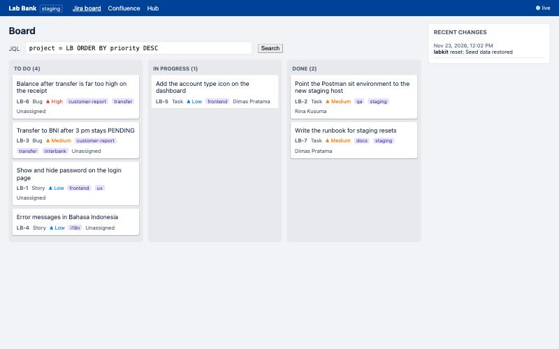
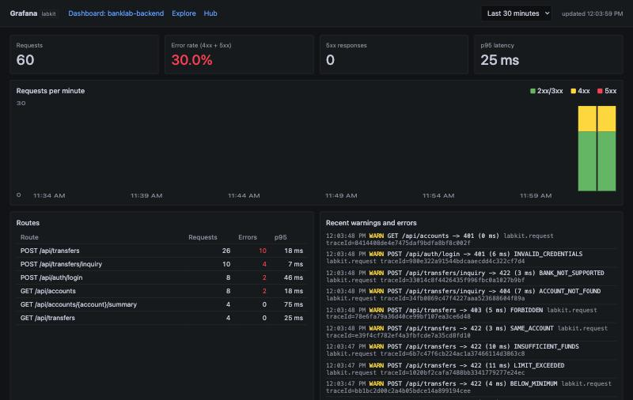

# Labkit: Lab Bank staging on your laptop

Labkit is a small "staging" for Day 2. It gives Kiro a Jira, a Confluence, Grafana logs and metrics, and a read-only database. Everything runs on your laptop, on `127.0.0.1`. All data is dummy.


| Part | Address | What it is |
|---|---|---|
| Hub | http://127.0.0.1:4300 | Links, status, reset |
| Jira + Confluence | http://127.0.0.1:4310 | Tickets (project `LB`) and pages (space `LB`) |
| Grafana | http://127.0.0.1:4330 | Backend logs and metrics |
| Backend API | http://127.0.0.1:8080 | The Lab Bank app, with the `labkit` profile |
| Staging DB | `127.0.0.1:5435` | Read-only access to the app data |

Kiro talks to these through four MCP servers: `labkit-atlassian`, `labkit-grafana`, `labkit-db` and `labkit-ping`.

## What you need

- Windows 10 or 11, Mac or Linux
- Node.js 22 or newer
- JDK 17
- Kiro

No `npm install`. Labkit has no dependencies.

## 1. Check your laptop (once, before the training)

In File Explorer, open the repo folder, then the `labkit` folder, and double-click `preflight.cmd`. Or in a terminal:

```bat
labkit\preflight.cmd
```

It takes a few seconds and writes `labkit\preflight-report.txt`. Send that file to the trainer.

- `FAIL` lines must be fixed before the training.
- `WARN` and `INFO` lines are fine to send as they are.

## 2. Start labkit

Open two terminals in the repo folder.

**Terminal 1: labkit**

```bat
labkit\start.cmd
```

Wait for three `OK` lines. Keep this window open.

**Terminal 2: the backend, with the labkit profile**

```bat
labkit\backend.cmd
```

Wait for `Started BankLabApplication`. The first start downloads Maven and needs a few minutes.

> In PowerShell, use `labkit\backend.cmd` too. If you run Maven yourself, quote the profile:
> `.\mvnw.cmd spring-boot:run "-Dspring-boot.run.profiles=labkit"`

Optional, **Terminal 3: the web app**: `cd frontend`, then `npm start`.

Now open http://127.0.0.1:4300. All parts should show a green dot (the web app only if you started it).

## 3. Connect Kiro

1. Open the repo folder in Kiro. Kiro reads `.kiro/settings/mcp.json`.
2. Open the Kiro panel, then **MCP servers**. You should see `labkit-ping`, `labkit-atlassian`, `labkit-grafana` and `labkit-db`.
3. In the chat, ask: *Call the labkit ping tool.* Kiro should answer with `pong`.

If the servers show an error, write the config with full paths and reload the servers in Kiro:

```bat
node labkit\cli.mjs kiro-config --absolute --write
```

The hub has the same config under **Show config with full paths**.

Kiro runs read-only tools without asking. It asks you before it changes Jira or Confluence, and before every SQL query.

## 4. Try it

Ask Kiro, one by one:

- *Search Jira for open bugs in project LB, highest priority first.*
- *Read the newest customer report and summarize it.*
- *Look in the Grafana logs for failed API calls in the last hour.*
- *Show the last 5 transfers in the staging DB.*
- *Add a comment to the ticket with what you found, and move it to In Progress.*
- *Create a postmortem page in Confluence space LB from the postmortem template.*

Watch the Jira board in the browser. It updates when Kiro changes something.





## What the tools can do

| Server | Tools |
|---|---|
| `labkit-atlassian` | `searchJiraIssuesUsingJql`, `getJiraIssue`, `createJiraIssue`, `editJiraIssue`, `addCommentToJiraIssue`, `getTransitionsForJiraIssue`, `transitionJiraIssue`, `getConfluenceSpaces`, `getPagesInConfluenceSpace`, `searchConfluenceUsingCql`, `getConfluencePage`, `createConfluencePage`, `updateConfluencePage`, and a few lookups |
| `labkit-grafana` | `list_datasources`, `query_loki_logs`, `list_loki_label_names`, `list_loki_label_values`, `list_prometheus_metric_names`, `query_prometheus` |
| `labkit-db` | `list_tables`, `describe_table`, `query` (SELECT only) |
| `labkit-ping` | `ping` |

The names match the real Atlassian and Grafana MCP servers, so the same prompts work at work.

Query languages are small subsets:

| Language | Supported |
|---|---|
| JQL | `project`, `status`, `assignee`, `reporter`, `priority`, `issuetype`, `labels`, `text ~`, `summary ~`, `created`/`updated` (`-7d`), `= != IN, NOT IN, IS EMPTY`, `AND OR NOT`, `ORDER BY` |
| CQL | `space`, `title ~`, `text ~`, `type`, `created`, `lastmodified` |
| LogQL | `{job="banklab-backend", level=~"warn\|error"}`, `\|= "text"`, `!= "text"`, `\|~ "regex"`, `\| json`, `\| status >= 400`, `count_over_time`, `rate`, `sum by` |
| PromQL | `http_requests_total`, `http_request_duration_seconds_bucket`, `log_messages_total`; `rate`, `increase`, `sum by`, `histogram_quantile` |

## No MCP? Use the CLI

Every MCP tool also runs from the command line. It is the same code.

```bat
node labkit\cli.mjs atlassian
node labkit\cli.mjs atlassian search --jql "project = LB AND status = \"To Do\""
node labkit\cli.mjs atlassian issue LB-1
node labkit\cli.mjs atlassian comment LB-1 --commentBody-file note.md
node labkit\cli.mjs atlassian transitions LB-1
node labkit\cli.mjs atlassian transition LB-1 21
node labkit\cli.mjs atlassian create-page --spaceId LB --title "My page" --body-file page.md
node labkit\cli.mjs grafana logs --logql "{job=\"banklab-backend\"} | json | status >= 400"
node labkit\cli.mjs grafana metrics --expr "sum by (status) (increase(http_requests_total[1h]))"
node labkit\cli.mjs db tables
node labkit\cli.mjs db sql "SELECT * FROM transfers ORDER BY created_at DESC LIMIT 5"
node labkit\cli.mjs status
```

Tips:

- Run `node labkit\cli.mjs <service>` to list its tools and arguments.
- Quoting is hard in `cmd`. Put long text in a file and use `--<name>-file`, for example `--commentBody-file note.md`.

## Reset

| What | How |
|---|---|
| Jira and Confluence | `labkit\reset.cmd`, or **Reset Jira + Confluence** on the hub |
| Database | Stop and start the backend. The data is in memory. |
| Grafana | **Clear Grafana logs** on the hub, or delete `backend\logs\app.json` while the backend is stopped |

## Troubleshooting

| Problem | Fix |
|---|---|
| `start.cmd` says a port is in use | Another program uses it, or labkit already runs. Run `node labkit\cli.mjs status`. |
| Hub shows the staging DB as not running | Start the backend with `labkit\backend.cmd`, not with plain `mvnw`. |
| Grafana shows no logs | The backend must run with the labkit profile. Then use the app, or click **Run traffic** on the hub. |
| `JAVA_HOME is not set` | Install JDK 17, set `JAVA_HOME` to its folder, open a new terminal. |
| Kiro shows the MCP servers in red | Run `node labkit\cli.mjs kiro-config --absolute --write` and reload. Check that `node -v` works in a new terminal. |
| `ExperimentalWarning: SQLite` | Harmless. `start.cmd` hides it. |
| The browser asks to allow a network connection | Labkit only listens on `127.0.0.1`. You can deny it. |

## Optional: Playwright MCP

Kiro can drive Chrome through the Playwright MCP server. It needs npm access and Chrome. Day 2 works without it.

To turn it on, set `"disabled": false` for `playwright` in `.kiro/settings/mcp.json`, then reload the MCP servers in Kiro. The first start downloads `@playwright/mcp` with `npx`.

## For trainers

- `labkit\traffic.cmd` (or **Run traffic** on the hub) sends about 30 API calls: logins, transfers, a retry with the same `Idempotency-Key`, and requests that break PRD rules R2 to R7. Money moves in pairs, so balances end where they started. One Rp25.000 transfer goes to another bank. Each run uses Rp50.000 of the daily limit of account `******7890`.
- `labkit\traffic.cmd --loop 15` keeps light traffic going, one round every 15 seconds.
- Backend changes for labkit live in one package, `com.example.banklab.labkit`, and only load with the `labkit` profile. Without the profile the app behaves as before.
- Run the labkit tests: `node --test labkit/test/*.test.mjs`. With labkit and the backend running, `set LABKIT_E2E=1` first to also run the end-to-end check.

## How it works

```
Kiro ──stdio──► labkit/mcp/atlassian.mjs ──HTTP──► services/atlassian  :4310  (node:sqlite)
     ──stdio──► labkit/mcp/grafana.mjs   ──HTTP──► services/grafana    :4330  (reads backend/logs/app.json)
     ──stdio──► labkit/mcp/db.mjs        ──PG────► backend, H2 PG server :5435 (read-only user)
```

See `labkit/PLAN.md` for the design.
