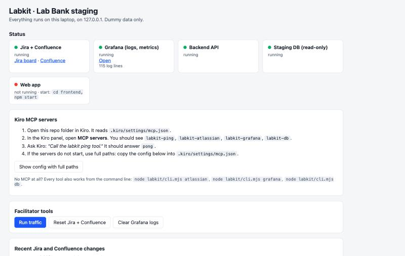
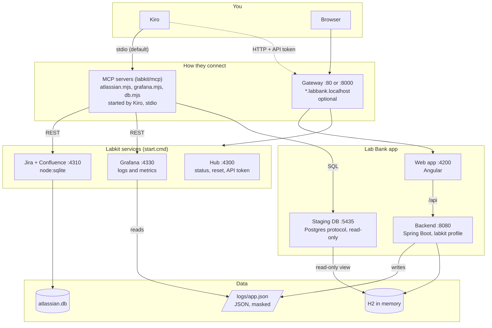
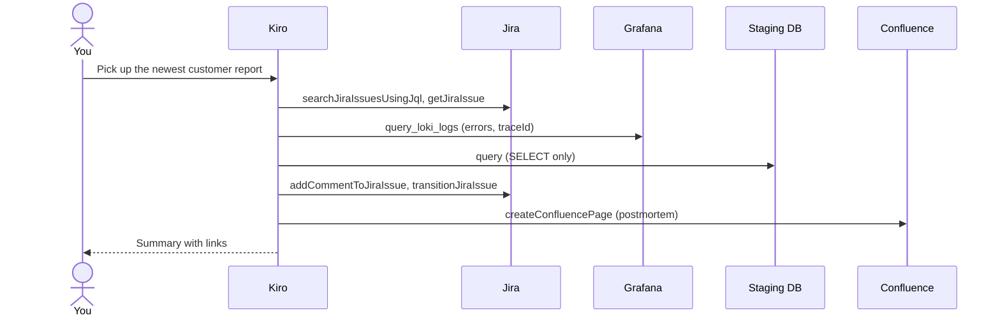

# Labkit: Lab Bank staging on your laptop

Labkit is a small "staging" for Day 2. It gives Kiro a Jira, a Confluence, Grafana logs and metrics, and a read-only database. Everything runs on your laptop, on `127.0.0.1`. All data is dummy.



| Part | Address | What it is |
|---|---|---|
| Hub | http://127.0.0.1:4300 | Links, status, reset |
| Jira + Confluence | http://127.0.0.1:4310 | Tickets (project `LB`) and pages (space `LB`) |
| Grafana | http://127.0.0.1:4330 | Backend logs and metrics |
| Backend API | http://127.0.0.1:8080 | The Lab Bank app, with the `labkit` profile |
| Staging DB | `127.0.0.1:5435` | Read-only access to the app data |

### Friendly names

`start.cmd` also starts a small gateway, so you can use names instead of ports:

| Name | Goes to |
|---|---|
| http://labkit.localhost | Hub |
| http://jira.labbank.localhost | Jira |
| http://confluence.labbank.localhost | Confluence |
| http://grafana.labbank.localhost | Grafana |
| http://api.labbank.localhost | Backend API |
| http://app.labbank.localhost | Web app |

- Names that end in `.localhost` always point to your own computer. No DNS server, no hosts file, no admin rights.
- The gateway uses port 80 when it can (Windows), else port 8000. On a Mac it is 8000, so add `:8000`, for example http://jira.labbank.localhost:8000.
- The `127.0.0.1` addresses always work too. `preflight.cmd` checks that the names work on your laptop.

Kiro talks to these through four MCP servers: `labkit-atlassian`, `labkit-grafana`, `labkit-db` and `labkit-ping`.

## Architecture

Everything runs on your laptop and listens on `127.0.0.1` only.



| Part | What it does |
|---|---|
| MCP servers | Small Node programs. Kiro starts them and talks to them over stdio. Each turns tool calls into REST calls or SQL. |
| Gateway | Optional. Sends each `*.labbank.localhost` name to the right port, so you can use names instead of ports. |
| Jira + Confluence | A mock with Jira- and Confluence-shaped REST APIs, stored in `labkit/data/atlassian.db`. |
| Grafana | A mock that reads the backend's JSON log, and answers log queries (LogQL) and metric queries (PromQL). |
| Backend, labkit profile | The normal app, plus JSON logs with masked account numbers, and a read-only staging DB for `db.mjs`. Without the profile it runs as before. |

A typical Day 2 loop, as Kiro sees it:



## What you need

- Windows 10 or 11, Mac or Linux
- Node.js 22 or newer
- JDK 17
- Kiro

No `npm install`. Labkit has no dependencies.

## 1. Check your laptop (once, before the training)

In File Explorer, open the repo folder, then the `labkit` folder, and double-click `preflight.cmd`. Or in a terminal:

```bat
labkit\preflight.cmd
```

It takes a few seconds and writes `labkit\preflight-report.txt`. Send that file to the trainer.

- `FAIL` lines must be fixed before the training.
- `WARN` and `INFO` lines are fine to send as they are.

## 2. Start labkit

Open two terminals in the repo folder.

**Terminal 1: labkit**

```bat
labkit\start.cmd
```

Wait for the `OK` lines. Keep this window open. The `gateway` line may say `OFF`; labkit still works on the `127.0.0.1` addresses.

**Terminal 2: the backend, with the labkit profile**

```bat
labkit\backend.cmd
```

Wait for `Started BankLabApplication`. The first start downloads Maven and needs a few minutes.

On a Mac or Linux, use these instead of the `.cmd` files:

| Step | Command (repo folder) |
|---|---|
| Preflight | `node labkit/preflight.mjs` |
| Labkit | `node labkit/start.mjs` |
| Backend | `cd backend && SPRING_PROFILES_ACTIVE=labkit ./mvnw spring-boot:run` |
| Traffic | `node labkit/traffic.mjs` |
| Reset | `node labkit/cli.mjs reset` |

> In PowerShell, use `labkit\backend.cmd` too. If you run Maven yourself, quote the profile:
> `.\mvnw.cmd spring-boot:run "-Dspring-boot.run.profiles=labkit"`

Optional, **Terminal 3: the web app**: `cd frontend`, then `npm start`.

Now open the hub: http://labkit.localhost (on a Mac: http://labkit.localhost:8000, or always http://127.0.0.1:4300). All parts should show a green dot (the web app only if you started it).

## 3. Connect Kiro

The repo has no MCP config. You add the servers yourself, one at a time, and test each one.

1. In Kiro, open the **MCP servers** panel and open the **workspace** config. Or create the file `.kiro/settings/mcp.json` in the repo folder yourself. (Menu names can differ a little between Kiro versions.)
2. Add the smallest server first and save:

```json
{
  "mcpServers": {
    "labkit-ping": {
      "command": "node",
      "args": ["labkit/mcp/ping.mjs"],
      "disabled": false,
      "autoApprove": []
    }
  }
}
```

3. The server should turn green. In the chat, ask: *Call the labkit ping tool.* Kiro asks before it runs the tool, because `autoApprove` is empty. Answer yes; it should reply `pong`.
4. Add the other three servers the same way. Only the file name in `args` changes. Test each one:

| Server | `args` | Try |
|---|---|---|
| `labkit-atlassian` | `["labkit/mcp/atlassian.mjs"]` | *List the Jira projects.* |
| `labkit-grafana` | `["labkit/mcp/grafana.mjs"]` | *Show errors from the last hour.* |
| `labkit-db` | `["labkit/mcp/db.mjs"]` | *List the tables in the staging DB.* |

5. Decide what Kiro may run without asking. Put only **read-only** tools in `autoApprove`, for example `["searchJiraIssuesUsingJql", "getJiraIssue"]` or `["list_tables", "describe_table"]`. Keep tools that change Jira or Confluence, and the DB `query` tool, out of it, so Kiro asks you first.

If a server stays red:

- Check that `node -v` works in a new terminal.
- Use the full path to the file in `args`, for example `"C:\\Users\\you\\pwdk-bca-lab\\labkit\\mcp\\ping.mjs"`.
- The hub's **Show config with full paths** button gives the exact text.

Stuck, or short on time? This writes the full config for you:

```bat
node labkit\cli.mjs kiro-config --write
```

Add `--absolute` for full paths.

## 3b. Optional: connect like a remote server

Real products (Atlassian, GitHub and others) give you a **URL** and a **sign-in or API token**, not a program to run. Labkit can act like that too, on `127.0.0.1`:

| Server | URL (add `:8000` after the name if the gateway uses port 8000) | Without the gateway |
|---|---|---|
| `labkit-atlassian` | `http://jira.labbank.localhost/mcp` | `http://127.0.0.1:4310/mcp` |
| `labkit-grafana` | `http://grafana.labbank.localhost/mcp` | `http://127.0.0.1:4330/mcp` |
| `labkit-db` | `http://db.labbank.localhost/mcp` | `http://127.0.0.1:4300/mcp/db` |
| `labkit-ping` | `http://labkit.localhost/mcp/ping` | `http://127.0.0.1:4300/mcp/ping` |

1. Open the hub. Under **Remote MCP servers (simulated)**, click **Show** to see your API token. Each laptop has its own.
2. Put the servers in your **user** config, `%USERPROFILE%\.kiro\settings\mcp.json` (Mac: `~/.kiro/settings/mcp.json`), not in the repo. A token in the repo ends up in git.
3. One entry looks like this:

```json
{
  "mcpServers": {
    "labkit-atlassian": {
      "url": "http://jira.labbank.localhost/mcp",
      "headers": { "Authorization": "Bearer <your labkit API token>" }
    }
  }
}
```

4. Reload the MCP servers in Kiro. Without the token, or with a wrong one, the server answers `401`.

The hub's **Show remote config** button, or `node labkit\cli.mjs kiro-config --remote`, prints the full config with your token and the right port. Use either the local servers (section 3) or the remote ones, not both, or Kiro shows every tool twice.

The remote endpoints follow the MCP "Streamable HTTP" transport: `POST` with JSON-RPC, an `Mcp-Session-Id` from `initialize`, `401` without a valid Bearer token, `403` for a web page from another origin.

## 4. Try it

Ask Kiro, one by one:

- *Search Jira for open bugs in project LB, highest priority first.*
- *Read the newest customer report and summarize it.*
- *Look in the Grafana logs for failed API calls in the last hour.*
- *Show the last 5 transfers in the staging DB.*
- *Add a comment to the ticket with what you found, and move it to In Progress.*
- *Create a postmortem page in Confluence space LB from the postmortem template.*

Watch the Jira board in the browser. It updates when Kiro changes something.


## What the tools can do

| Server | Tools |
|---|---|
| `labkit-atlassian` | `searchJiraIssuesUsingJql`, `getJiraIssue`, `createJiraIssue`, `editJiraIssue`, `addCommentToJiraIssue`, `getTransitionsForJiraIssue`, `transitionJiraIssue`, `getConfluenceSpaces`, `getPagesInConfluenceSpace`, `searchConfluenceUsingCql`, `getConfluencePage`, `createConfluencePage`, `updateConfluencePage`, and a few lookups |
| `labkit-grafana` | `list_datasources`, `query_loki_logs`, `list_loki_label_names`, `list_loki_label_values`, `list_prometheus_metric_names`, `query_prometheus` |
| `labkit-db` | `list_tables`, `describe_table`, `query` (SELECT only) |
| `labkit-ping` | `ping` |

The names match the real Atlassian and Grafana MCP servers, so the same prompts work at work.

Query languages are small subsets:

| Language | Supported |
|---|---|
| JQL | `project`, `status`, `assignee`, `reporter`, `priority`, `issuetype`, `labels`, `text ~`, `summary ~`, `created`/`updated` (`-7d`), `= != IN, NOT IN, IS EMPTY`, `AND OR NOT`, `ORDER BY` |
| CQL | `space`, `title ~`, `text ~`, `type`, `created`, `lastmodified` |
| LogQL | `{job="banklab-backend", level=~"warn\|error"}`, `\|= "text"`, `!= "text"`, `\|~ "regex"`, `\| json`, `\| status >= 400`, `count_over_time`, `rate`, `sum by` |
| PromQL | `http_requests_total`, `http_request_duration_seconds_bucket`, `log_messages_total`; `rate`, `increase`, `sum by`, `histogram_quantile` |

## No MCP? Use the CLI

Every MCP tool also runs from the command line. It is the same code.

```bat
node labkit\cli.mjs atlassian
node labkit\cli.mjs atlassian search --jql "project = LB AND status = \"To Do\""
node labkit\cli.mjs atlassian issue LB-1
node labkit\cli.mjs atlassian comment LB-1 --commentBody-file note.md
node labkit\cli.mjs atlassian transitions LB-1
node labkit\cli.mjs atlassian transition LB-1 21
node labkit\cli.mjs atlassian create-page --spaceId LB --title "My page" --body-file page.md
node labkit\cli.mjs grafana logs --logql "{job=\"banklab-backend\"} | json | status >= 400"
node labkit\cli.mjs grafana metrics --expr "sum by (status) (increase(http_requests_total[1h]))"
node labkit\cli.mjs db tables
node labkit\cli.mjs db sql "SELECT * FROM transfers ORDER BY created_at DESC LIMIT 5"
node labkit\cli.mjs status
```

Tips:

- Run `node labkit\cli.mjs <service>` to list its tools and arguments.
- Quoting is hard in `cmd`. Put long text in a file and use `--<name>-file`, for example `--commentBody-file note.md`.

## Reset

| What | How |
|---|---|
| Jira and Confluence | `labkit\reset.cmd`, or **Reset Jira + Confluence** on the hub |
| Database | Stop and start the backend. The data is in memory. |
| Grafana | **Clear Grafana logs** on the hub, or delete `backend\logs\app.json` while the backend is stopped |

## Troubleshooting

| Problem | Fix |
|---|---|
| `start.cmd` says a port is in use | Another program uses it, or labkit already runs. Run `node labkit\cli.mjs status`. |
| Hub shows the staging DB as not running | Start the backend with `labkit\backend.cmd`, not with plain `mvnw`. |
| Grafana shows no logs | The backend must run with the labkit profile. Then use the app, or click **Run traffic** on the hub. |
| `JAVA_HOME is not set` | Install JDK 17, set `JAVA_HOME` to its folder, open a new terminal. |
| Kiro shows the MCP servers in red | Check that `node -v` works in a new terminal. Use full paths in `args`, or run `node labkit\cli.mjs kiro-config --absolute --write` and reload. |
| `ExperimentalWarning: SQLite` | Harmless. `start.cmd` hides it. |
| `jira.labbank.localhost` does not open | Check the gateway line in `start.cmd` and `preflight.cmd`. Add `:8000` if the gateway uses 8000. Or use the `127.0.0.1` address. |
| The browser asks to allow a network connection | Labkit only listens on `127.0.0.1`. You can deny it. |

## Optional: Playwright MCP

Kiro can drive Chrome through the Playwright MCP server. It needs npm access and Chrome. Day 2 works without it.

To turn it on, add this entry to `.kiro/settings/mcp.json`, then reload the MCP servers in Kiro: `"playwright": { "command": "npx", "args": ["-y", "@playwright/mcp@latest", "--browser", "chrome"] }`. The first start downloads `@playwright/mcp` with `npx`.

## For trainers

- `labkit\traffic.cmd` (or **Run traffic** on the hub) sends about 30 API calls: logins, transfers, a retry with the same `Idempotency-Key`, and requests that break PRD rules R2 to R7. Money moves in pairs, so balances end where they started. One Rp25.000 transfer goes to another bank. Each run uses Rp50.000 of the daily limit of account `******7890`.
- `labkit\traffic.cmd --loop 15` keeps light traffic going, one round every 15 seconds.
- Backend changes for labkit live in one package, `com.example.banklab.labkit`, and only load with the `labkit` profile. Without the profile the app behaves as before.
- Run the labkit tests: `node --test labkit/test/*.test.mjs`. With labkit and the backend running, `set LABKIT_E2E=1` first to also run the end-to-end check.

## Code map

| Folder | What is in it |
|---|---|
| `labkit/lib/` | Shared code: MCP over stdio and HTTP (`mcp.mjs`), HTTP helpers, Postgres client (`pg.mjs`), host names and gateway, API token |
| `labkit/mcp/` | The MCP servers Kiro starts: `atlassian.mjs`, `grafana.mjs`, `db.mjs`, `ping.mjs` |
| `labkit/services/` | The services `start.cmd` runs: `hub`, `atlassian`, `grafana`, `gateway`, each with its web page in `ui/` |
| `labkit/seed/` | Jira tickets, Confluence pages and the traffic scenario |
| `labkit/test/` | Tests: `node --test labkit/test/*.test.mjs` |
| `backend/.../labkit/` | Backend code for the `labkit` profile: JSON request log with masking, read-only staging DB |

No npm or Maven dependencies were added. Labkit uses Node built-ins only (`node:http`, `node:sqlite`, `node:test`).

See `labkit/PLAN.md` for the design and the reasons behind it.
